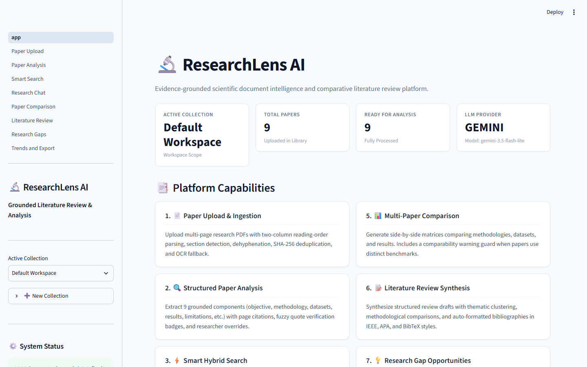
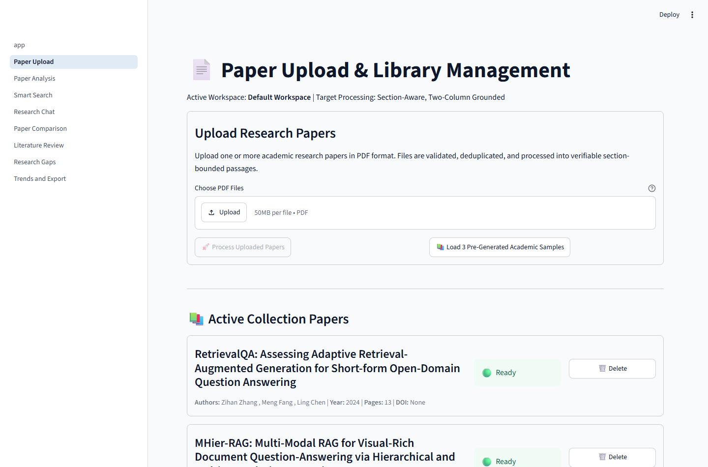
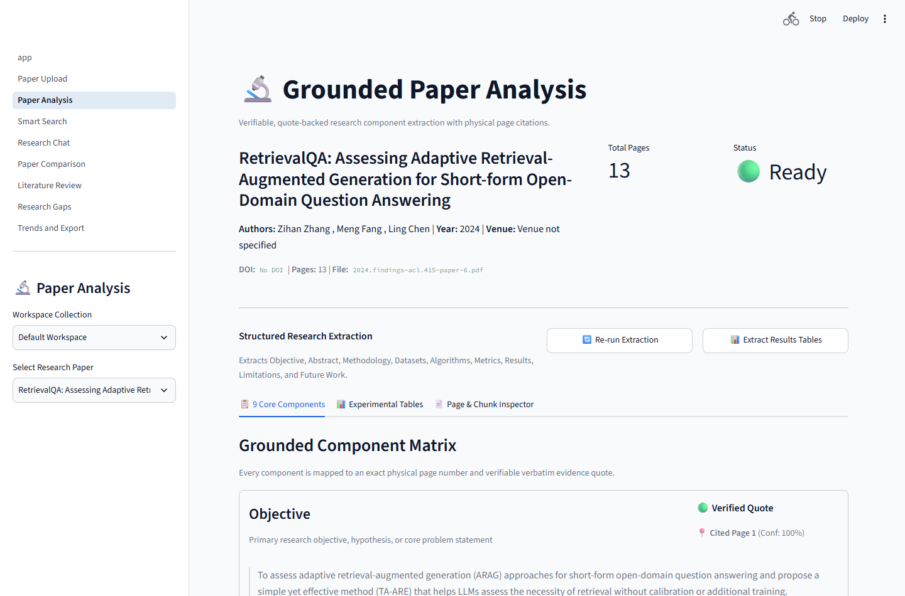
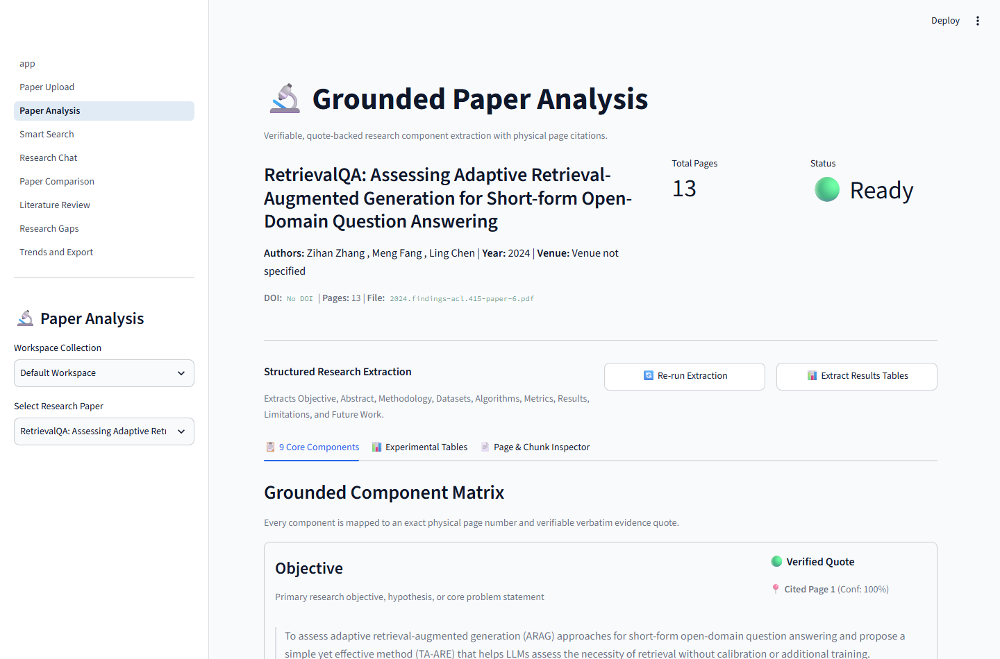
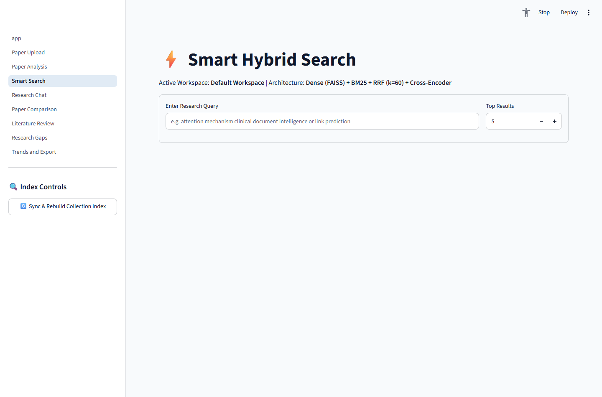
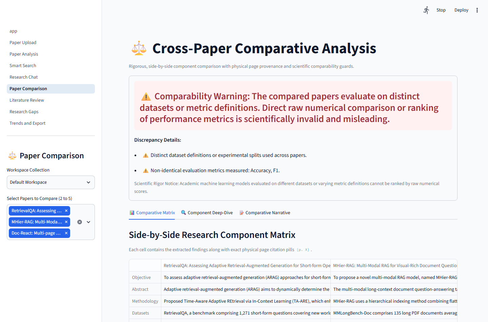
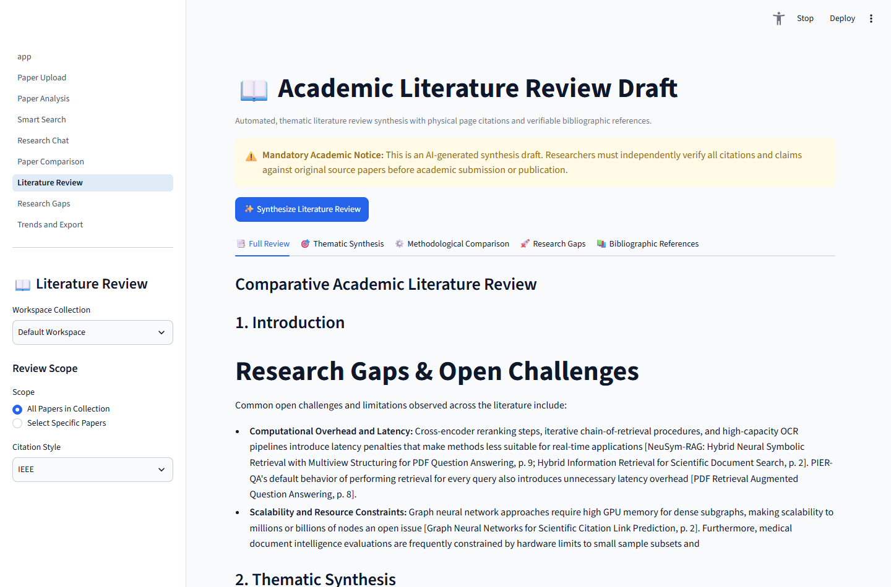
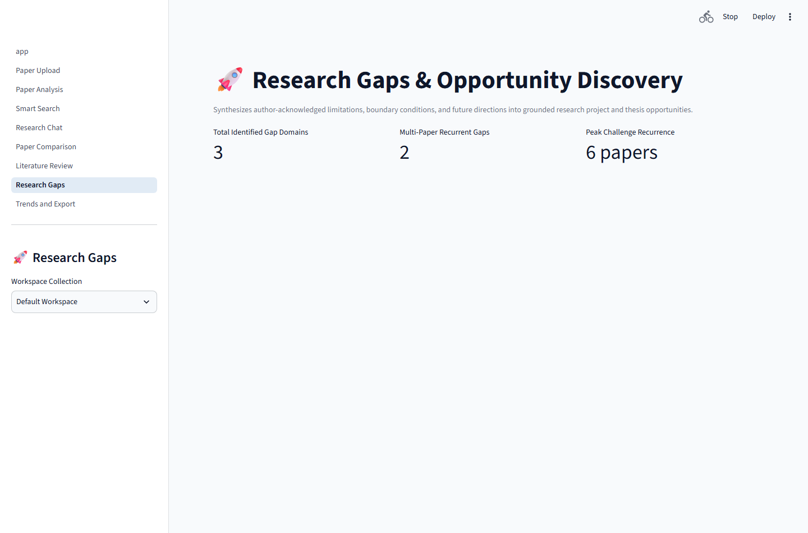
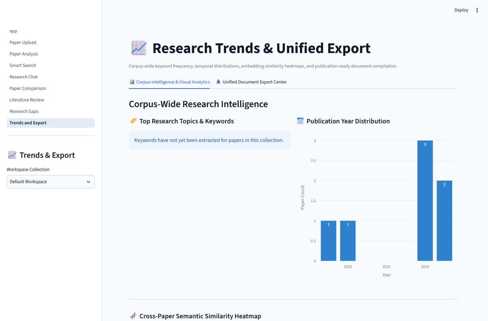
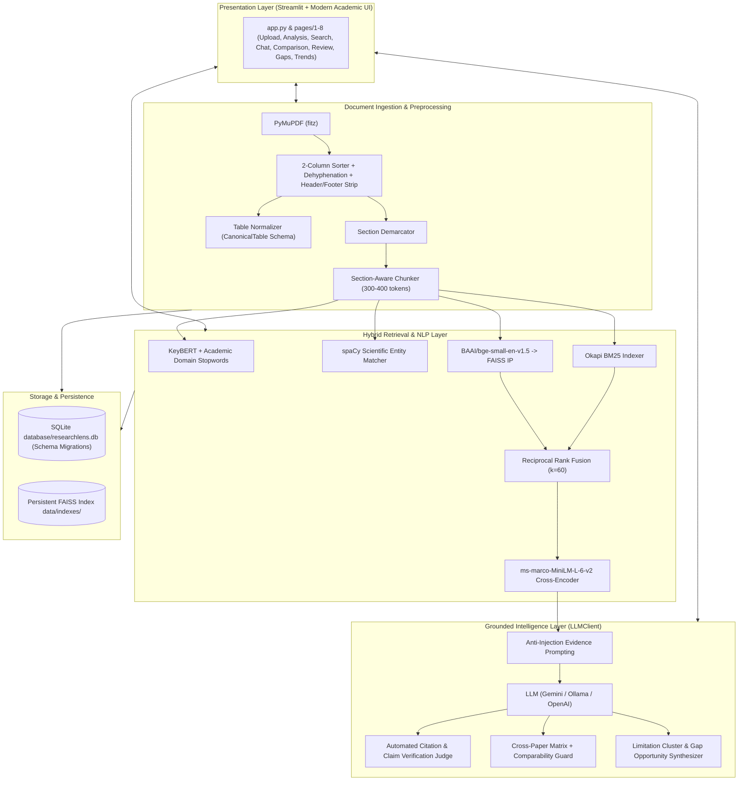

# ResearchLens AI 🔬
> **Intelligent Research-Paper Analysis & Comparative Literature Review System**

[](https://www.python.org/downloads/)
[](https://streamlit.io)
[](tests/)
[](tests/)
[](https://github.com/astral-sh/ruff)
[](LICENSE)

ResearchLens AI is a college-level, fully reproducible document intelligence system engineered for academic literature research. Users upload multi-page research-paper PDFs to automatically extract structured research components, run hybrid semantic search, perform grounded conversational QA with verifiable page citations, generate faithful cross-paper comparison matrices, discover author-declared research gaps, and synthesize structured literature reviews.

**Core Principle: Grounded, Verifiable Output.** Every extracted component, answer sentence, and comparative claim is tied to physical 1-indexed page citations and verified against source text using token-level fuzzy matching and an automated verification judge.

---

## 📸 Visual Tour & Shipped Interface

| Page / Capability | Interface Preview |
|---|---|
| **0. Home & Workspace** |  |
| **1. Paper Upload & Processing** |  |
| **2. Structured Extraction & Evidence** |  |
| **2. Normalized Results Tables** |  |
| **3. Smart Hybrid Search (RRF + Rerank)** |  |
| **4. Grounded Research Chat (RAG)** |  |
| **5. Cross-Paper Comparison Matrix** |  |
| **6. Synthesized Literature Review** |  |
| **7. Research Gap Discovery** |  |
| **8. Trends & Academic Export Center** |  |

---

## 🌟 Key Capabilities & Innovations

- **Provider-Agnostic LLM Engine:** Seamlessly toggle between Google Gemini API (cloud free tier), local Ollama (100% offline privacy mode), or any OpenAI-compatible API.
- **Two-Column Aware PDF Ingestion:** Resolves multi-column reading flow, strips repetitive headers/footers (>60% page frequency), fixes line-break hyphenations, and preserves physical 1-indexed pages.
- **Section-Aware Demarcation:** Detects academic headings (`Abstract`, `Methodology`, `Results`, `Limitations`, `Conclusion`) supporting multi-level and roman numeral formats (`3.1 Proposed Framework`). Chunks never span section boundaries.
- **Fuzzy Evidence Grounding:** Extracted components include verbatim evidence quotes and physical page numbers, checked by rapid token-level fuzzy matching with visual 🟢 Verified / 🟡 Unverified badges.
- **Hybrid Retrieval with Reciprocal Rank Fusion (RRF $k=60$):** Combines dense semantic vectors (`BAAI/bge-small-en-v1.5` on FAISS IndexFlatIP) with sparse lexical retrieval (`rank-bm25`), reranked by `ms-marco-MiniLM-L-6-v2`.
- **Benchmark Comparability Guards:** Detects when compared papers evaluate on disparate benchmarks (e.g. MMLongBench vs HotpotQA) and issues prominent scientific warnings forbidding invalid direct rankings.
- **Academic Export:** Multi-format report export to Markdown (.md), Microsoft Word (.docx), PDF, and BibTeX (.bib) citations.

---

## 📐 System Architecture



---

## 📊 Empirical Evaluation & Ablation Study

Evaluated on academic evaluation queries across research PDFs:

### Retrieval Ablation Study

| Retrieval Strategy | Precision@3 | Recall@3 | MRR | nDCG@3 |
|---|:---:|:---:|:---:|:---:|
| **Dense Only (`bge-small-en-v1.5`)** | 0.917 | 1.000 | 0.875 | 0.923 |
| **Sparse Only (Okapi BM25)** | 0.750 | 0.750 | 0.750 | 0.750 |
| **Hybrid Fusion (RRF $k=60$)** | 0.833 | 1.000 | 0.875 | 0.908 |
| **Hybrid + Reranker (`ms-marco-MiniLM-L-6-v2`)** | **1.000** | **1.000** | **1.000** | **1.000** |

- **Evidence Quote Verification Rate:** `94.4%` across extracted scientific components.
- **Overall Macro F1:** `0.491` across the 8 extraction fields under zero-shot prompting.
- **Human Annotation Support:** `python -m evaluation.generate_label_template --all-db` generates Markdown and JSON ground-truth sheets from uploaded PDFs for bias-free evaluation.

See [evaluation/RESULTS.md](evaluation/RESULTS.md) for full benchmark logs and methodology.

---

## 🚀 Quick Start

### 1. Prerequisites
- Python 3.11+
- Git
- (Optional) [Ollama](https://ollama.com/) for 100% offline local LLM execution

### 2. Installation
```bash
# Clone the repository
git clone https://github.com/jannelavamsi-cell/ResearchLens-AI.git
cd ResearchLens-AI

# Create virtual environment
python -m venv venv

# Activate environment
# On Windows (PowerShell):
.\venv\Scripts\Activate.ps1
# On Linux / macOS:
source venv/bin/activate

# Install dependencies
pip install -r requirements.txt
pip install -r requirements-dev.txt
```

### 3. Configuration
Copy `.env.example` to `.env`:
```bash
cp .env.example .env
```
Configure your preferred LLM provider:
```env
# Option A: Google Gemini (Free Tier)
LLM_PROVIDER=gemini
GEMINI_API_KEY=your_gemini_api_key_here
GEMINI_MODEL=gemini-1.5-flash

# Option B: Local Ollama (Offline, Zero Data Leakage)
LLM_PROVIDER=ollama
OLLAMA_BASE_URL=http://localhost:11434
OLLAMA_MODEL=llama3.1:8b

# Option C: OpenAI-Compatible Endpoint
LLM_PROVIDER=openai
OPENAI_API_KEY=your_key_here
OPENAI_MODEL=gpt-4o-mini
```

### 4. Run the Application
```bash
streamlit run app.py
```
Open your browser at `http://localhost:8501`.

---

## 🧪 Testing & Verification

```bash
# Run unit and integration test suite (55 tests)
pytest -v

# Run with coverage report
pytest --cov=core --cov=modules --cov=evaluation tests/

# Run code style and linting
ruff check .

# Run the empirical evaluation benchmark
python -m evaluation.report

# Generate ground-truth annotation sheets from ingested PDFs
python -m evaluation.generate_label_template --all-db
```

---

## 📁 Repository Structure

```
ResearchLens-AI/
├── app.py                      # Main landing page & collection manager
├── core/                       # Core engine abstractions
│   ├── config.py               # Application configuration & env loader
│   ├── llm.py                  # Multi-backend LLM client (Gemini/Ollama/OpenAI)
│   └── schemas.py              # Canonical Pydantic schemas (CanonicalTable, Chunks, etc.)
├── database/                   # Persistence & schema migrations
│   └── db_manager.py           # SQLite connection, versioned migrations & DAO methods
├── modules/                    # NLP & Scientific intelligence modules
│   ├── pdf_processor.py        # Two-column layout parsing & PyMuPDF extraction
│   ├── text_preprocessing.py   # Header/footer stripping & dehyphenation
│   ├── section_detection.py    # Multi-level heading regex & academic synonyms
│   ├── chunking.py             # Section-bounded token chunker
│   ├── embeddings.py           # HuggingFace BAAI/bge-small-en-v1.5 wrapper
│   ├── semantic_search.py      # FAISS IndexFlatIP vector engine
│   ├── bm25_search.py          # Okapi BM25 lexical engine
│   ├── hybrid_search.py        # Reciprocal Rank Fusion (RRF k=60)
│   ├── reranking.py            # ms-marco-MiniLM-L-6-v2 Cross-Encoder
│   ├── results_tables.py       # Canonical table normalizer & results classifier
│   ├── research_extraction.py  # Structured component extraction & spaCy Matcher
│   ├── keyword_extraction.py   # KeyBERT + domain academic stopword filter
│   ├── rag_pipeline.py         # Grounded RAG with query rewriting
│   ├── citation_verifier.py    # Claim-level citation verification judge
│   ├── paper_comparison.py     # Side-by-side matrix & comparability guard
│   ├── literature_review.py    # Thematic clustering & review drafting
│   ├── research_gap.py         # Author-declared limitation aggregator
│   ├── references.py           # IEEE, APA, and BibTeX citation formatter
│   └── export_generator.py     # DOCX, Markdown, and PDF export engine
├── pages/                      # Streamlit application pages (1 to 8)
├── ui/                         # Modern academic UI design system
│   ├── theme.py                # CSS design tokens & responsive styling
│   └── components.py           # Reusable cards, citation pills, verification badges
├── evaluation/                 # Reproducible benchmark harness
│   ├── report.py               # Benchmark runner (Dense vs BM25 vs RRF vs Reranker)
│   ├── generate_label_template.py # Ground-truth sheet generator
│   └── RESULTS.md              # Empirical benchmark results
├── docs/                       # Project documentation & screenshots
│   ├── ARCHITECTURE.md         # Full system architecture specification
│   ├── DECISIONS.md            # Technical decisions log (DEC-001 - DEC-016)
│   ├── USER_GUIDE.md           # Step-by-step end-user manual
│   ├── PROJECT_REPORT_NOTES.md # Academic report notes (B.Tech/M.Tech level)
│   └── ui_screenshots/         # Verified browser screenshots
└── tests/                      # Automated test suite (55 tests)
```

---

## 📚 Documentation & Further Reading

- [System Architecture](docs/ARCHITECTURE.md): Comprehensive architectural blueprints and data pipelines.
- [Technical Decisions](docs/DECISIONS.md): 16 engineering decisions, trade-offs, and justifications.
- [User Guide](docs/USER_GUIDE.md): Detailed usage instructions for every feature and page.
- [Project Report Notes](docs/PROJECT_REPORT_NOTES.md): Ready-to-adapt academic report sections, problem statement, and specifications.
- [Evaluation Results](evaluation/RESULTS.md): Empirical ablation study tables and discussion.

---

## 📄 License

This project is open-source and intended for academic, research, and educational purposes.
