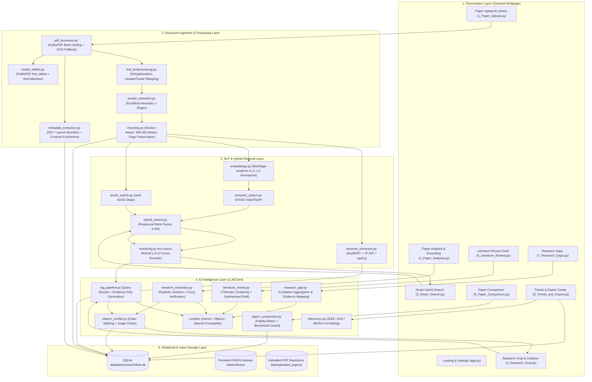

# ResearchLens AI: System Architecture

## 1. High-Level System Architecture

ResearchLens AI operates as a modular, five-layered system designed to process multi-page scientific papers, construct verifiable hybrid indices, and support grounded interactive inquiry and literature synthesis.

---

## 2. Ingestion & Retrieval Data Flow

### 2.1 Ingestion Flow
1. **Upload & Deduplication:** File uploaded via `pages/1_Paper_Upload.py`. SHA-256 hash computed. If duplicate exists in the active collection, an alert is returned.
2. **Two-Column Reading Order:** PyMuPDF parses text blocks in geometric reading order. Pages are preserved 1-indexed.
3. **Noise Reduction:** Headers, footers, and page numbers repeating across $>60\%$ of pages are stripped. Hyphenation across line breaks is resolved.
4. **Section Demarcation:** Heading heuristics detect sections (`Abstract`, `Introduction`, `Methodology`, etc.). Chunks are generated strictly within section boundaries.
5. **Dual Indexing:** Text chunks are indexed into disk-backed BM25 and embedded via `BAAI/bge-small-en-v1.5` into FAISS `IndexFlatIP`.
6. **Structured Extraction:** Core research components are extracted via `LLMClient` with Pydantic JSON schemas, and verbatim quotes are verified against source page text using fuzzy matching.

### 2.2 Query & Verification Flow
1. **Query Reformulation:** If part of a conversation, follow-up queries are rewritten to be standalone.
2. **Hybrid Fusion:** FAISS dense retrieval and BM25 sparse retrieval fetch top-$K$ candidates each, combined using Reciprocal Rank Fusion ($k=60$):
   $$RRF\_score(d) = \sum_{m \in \{dense, sparse\}} \frac{1}{60 + rank_m(d)}$$
3. **Cross-Encoder Reranking:** Top 20 fusion candidates are scored by `cross-encoder/ms-marco-MiniLM-L-6-v2` to select the top 5 most relevant passages.
4. **Evidence-Grounded Prompting:** Excerpts are formatted inside passive `<documents>` tags with anti-injection instructions.
5. **Automated Claim Verification:** Generated answer sentences are split and checked against cited chunks. Unsupported claims are visually flagged in the UI.
